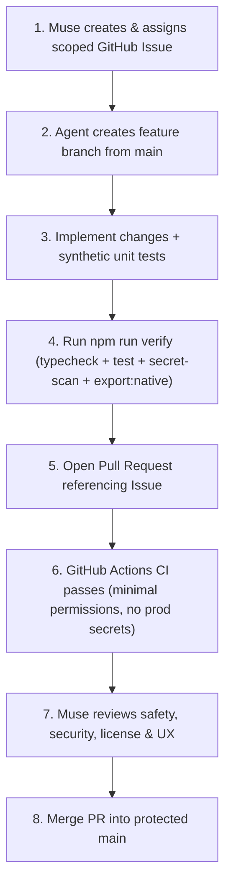

# Multi-Agent Workflow (`CoCo App`)

## 1. Governance & Roles

- **Muse (Coordinator & Reviewer)**: Owns milestone planning, GitHub Issue grooming, agent task assignment, security/safety code review, and merge approval on `main`.
- **Gemini (Chief Architect & Migration Lead)**: Delivered the initial extraction from `coco-os`, native Expo React Native foundation, protocol parity tests, and CI security gates.
- **Annie's & Authorized Specialist Agents**: Pick up explicitly assigned GitHub Issues for Android/iOS native builds, voice/audio integration, device telemetry/control panels, and UI polish.

## 2. Standard Execution Flow

## 3. Branch Naming & Commit Conventions

- Feature work: `feat/<issue-id>-<short-slug>` (e.g. `feat/1-android-eas-build`)
- Bug fixes: `fix/<issue-id>-<short-slug>`
- Documentation / governance: `docs/<short-slug>`
- CI / tooling: `chore/<short-slug>`

Never force-push to `main` and never commit directly to `main` once branch protection is enabled.

## 4. Security & Review Checklist (For Muse & Reviewers)

- [ ] No hardcoded URLs, private IPs, API keys, bearer tokens, certificates, or `.env` files.
- [ ] All test fixtures are synthetic; no real device IDs or session data.
- [ ] Emergency STOP remains globally reachable, omits `X-CoCo-Control-*` headers, and reports true server outcomes.
- [ ] Unimplemented features remain clearly labeled `TODO` (no fake success paths in Live Mode).
- [ ] New dependencies use permissive licenses (MIT / Apache-2.0 / BSD / ISC) and are documented in `NOTICE.md` when required.
- [ ] CI runs cleanly with read-only permissions and zero production secrets.
- [ ] Agent performed zero production deployments and accessed zero production credentials.
