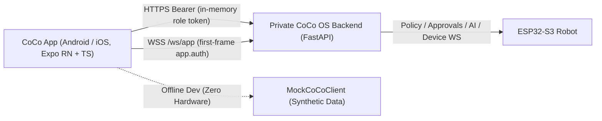

# CoCo App Architecture

## 1. Purpose & Boundary with Private CoCo OS

**CoCo App** is the public standalone native mobile companion client (Android & iOS) for the CoCo robot platform.

- **Public (`DinsourZ/coco-app`)**: Mobile UI, platform-agnostic API client, WebSocket client, client-facing JSON Schemas, TypeScript protocol validators, synthetic Mock Mode, tests, and collaboration docs.
- **Private (`DinsourZ/coco-os`)**: FastAPI backend, AI provider integrations & keys, tool execution policy & approval store, device WebSocket gateway & mTLS PKI, ESP32-S3 firmware, mechanical v3.1 CAD, Sentinel ops/telemetry storage, and deployment configs.

## 2. Mobile Stack Evaluation (Expo React Native vs. Flutter)

Before scaffolding `coco-app`, `DinsourZ/coco-os` (`integration/coco-full-recovery-20261114` @ `8b981d7befd6c733f4b7b5942cabd4a64d8f92c8`) was audited:

| Criterion | Expo React Native + TypeScript | Flutter (Dart) |
|---|---|---|
| Existing mobile code in `coco-os` | React 18.3 + TypeScript 5.5 console (`platform/web/src/api/*`) | None (0 Dart/Flutter files) |
| Reuse of verified protocol validators | High — direct port of `exactJson`, `controlContext`, `displayObservation`, `chatCancellation`, `ownedApprovals`, `approvalResponses`, `ApiError`, and REST/WS contracts | Low — full manual rewrite in Dart with drift risk against backend |
| Native Android & iOS output | Genuine native Android/iOS builds via React Native 0.76 + Expo SDK 52 (not a PWA) | Genuine native builds |
| CI & local verification cost | Runs natively on standard Node 20 CI (`tsc`, `vitest`, `expo export --platform android --platform ios`) | Requires full Flutter SDK toolchain |

**Decision**: **Expo React Native + TypeScript** is selected for verifiable contract parity, low migration cost, and genuine native Android/iOS compilation.

## 3. Repository Structure

| Directory | Responsibility |
|---|---|
| `protocol/` | Extracted client-facing JSON Schemas & protocol specification (`app_message`, `tool_call`, `audio_*`, `voice_utterance`). |
| `packages/protocol/` | Pure TypeScript types and strict runtime validators (`exactJson`, `controlContext`, `displayObservation`, `chatCancellation`, `ownedApprovals`, `approvalResponses`, `deviceObservation`). Zero DOM/browser globals. |
| `packages/api-client/` | Platform-agnostic `HttpCoCoClient`, `openAppSocket` (`/ws/app`), `InMemoryAuthStore`, `validateBackendUrl`, `ApiError`/`operatorErrorMessage`, and synthetic `MockCoCoClient`. |
| `src/` | Native Expo React Native UI (`App.tsx`, `CoCoContext`, `AppNavigator`, global `EmergencyStopBar`, `ChatScreen`, `DevicesScreen`, `PairingScreen`, `SettingsScreen`). |
| `tests/` | Vitest unit & backend-contract test suites using 100% synthetic fixtures. |
| `scripts/secret_scan.mjs` | Deterministic scanner enforcing zero secrets, zero private IPs/URLs, zero forbidden files, and permissive direct dependency licenses. |
| `docs/` | Architecture, migration provenance (`MIGRATION_MAP.md`), and multi-agent workflow (`AGENT_WORKFLOW.md`). |

## 4. Security & Safety Invariants

1. **Configurable HTTPS/WSS Only**: Remote backends must use `https://` (`wss://` for `/ws/app`). Cleartext `http://`/`ws://` is blocked unless the user explicitly enables local loopback development (`localhost` / `127.0.0.1` / `[::1]`).
2. **Role-Scoped Volatile RAM Tokens**: `console`, `approver`, and `audit` tokens are held strictly in `InMemoryAuthStore`. Token revisions invalidate stale views and clear one-time pairing codes or rotated credentials immediately.
3. **First-Frame WebSocket Auth**: `/ws/app` sends `{"type":"app.auth","token":"..."}` as its first frame and sends `{"type":"ping"}` every 30s (within backend 300s idle timeout). Tokens never appear in URLs or cookies.
4. **Independent Emergency STOP**: `EmergencyStopBar` is mounted above tab navigation, invokes `POST /api/devices/{id}/motion/stop` without `X-CoCo-Control-*` precondition headers, displays real server confirmation or error, and reminds operators that software STOP does not replace physical power cutoff.
5. **Plain-Text Pairing QR**: `PairingScreen` renders a native View-based QR matrix encoding **only** the plain-text `pairing_code` — never an auto-claim URL or long-lived secret.
6. **Honest Phase-2 Boundaries**: Mobile microphone capture (`mobile_voice_input`), native audio playback (`mobile_audio_playback`), and push notifications (`push_notifications`) are explicitly represented as `not_implemented` (`TODO`).
